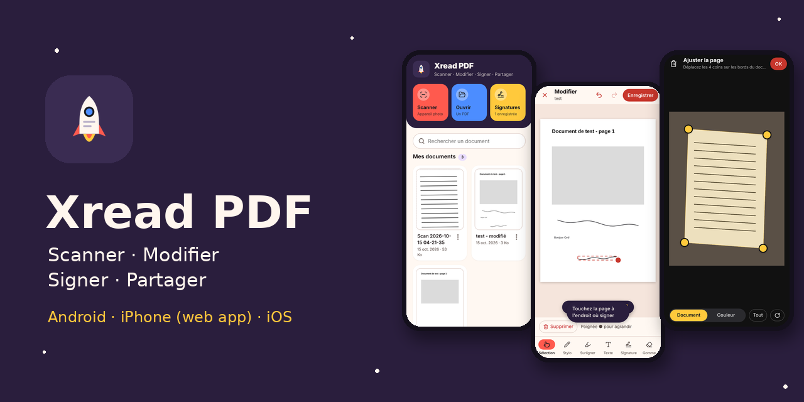
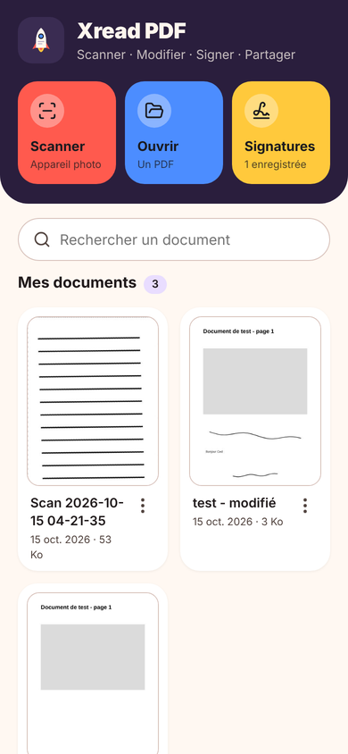
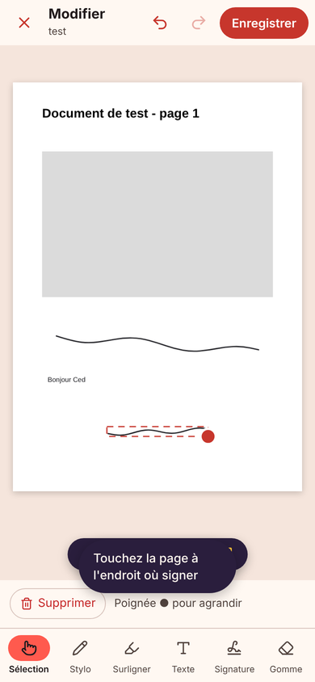
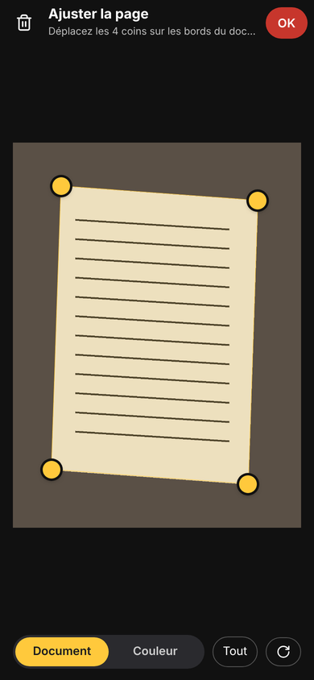
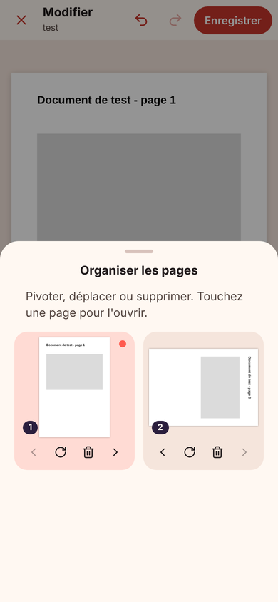

  

<h1 align="center">Xread PDF</h1>

  <b>Scanner, lire, annoter, signer et partager des PDF</b> — sur Android, iPhone et iPad. 
  Gratuit, sans compte, sans publicité. Vos documents restent sur votre appareil.

  
  
  

---

## Fonctions

| | |
|---|---|
| 📷 **Scanner** | Photo d'un document, recadrage des 4 coins avec redressement de la perspective, filtre « Document » noir et blanc, plusieurs pages en un PDF. |
| ✍️ **Signer** | Dessinez votre signature une fois, posez-la sur n'importe quel PDF, déplacez-la et ajustez sa taille. |
| 🖊️ **Annoter** | Stylo, surligneur, texte (« Date du jour », « Lu et approuvé »), gomme, annuler / rétablir, zoom. |
| 📄 **Organiser** | Pivoter, déplacer, supprimer des pages. Enregistrer par-dessus l'original ou en copie. |
| 💾 **Enregistrer où vous voulez** | Après un scan, choisissez le nom et l'emplacement : « Mes PDF » dans l'app, ou Téléchargements, Documents, carte SD, Drive… « Enregistrer sous… » pour tout PDF (Android). |
| 📤 **Partager** | Mail, WhatsApp, Drive, AirDrop… directement depuis l'app. |
| 🔒 **Local** | Aucun serveur : les PDF ne quittent pas votre téléphone, sauf si vous les partagez. |

Le contenu d'origine reste net : le texte du PDF reste sélectionnable, les annotations sont ajoutées par-dessus.

## Aperçu

  
  
  
  

## Installer

### iPhone / iPad (gratuit, sans expiration)
1. Ouvrir **https://toxletox74-prog.github.io/Xread-pdf/** dans **Safari**.
2. Toucher **Partager** puis **Sur l'écran d'accueil**.

L'app s'ouvre en plein écran et fonctionne hors ligne.

### Android
Télécharger **[Xread-PDF.apk](https://github.com/toxletox74-prog/Xread-pdf/releases/latest/download/Xread-PDF.apk)** puis l'ouvrir sur le téléphone (autoriser l'installation depuis cette source). Android 8.0 ou plus récent.

## Code source

| Plateforme | Dossier | Technologies |
|---|---|---|
| Android | [`android/`](android/) | Kotlin, Jetpack Compose, PdfRenderer, PdfBox-Android, ML Kit Document Scanner |
| iPhone / web | [`web/`](web/) | PWA sans build : Preact, pdf.js, pdf-lib, IndexedDB, service worker |
| iOS natif | [`ios/`](ios/) | SwiftUI, PDFKit, VisionKit (nécessite une signature Apple pour être installé) |

Chaque plateforme est compilée et testée par GitHub Actions : export PDF vérifié sur les 4 orientations de page, parcours complet testé sur émulateur Android, simulateur iPhone et navigateur mobile.

Les trois versions partagent le même modèle d'édition (coordonnées en points PDF, tracés lissés, format des signatures) et la même identité visuelle.

---

Xread PDF fait partie de la famille <b>Xread</b> — © Cédric Sarda

